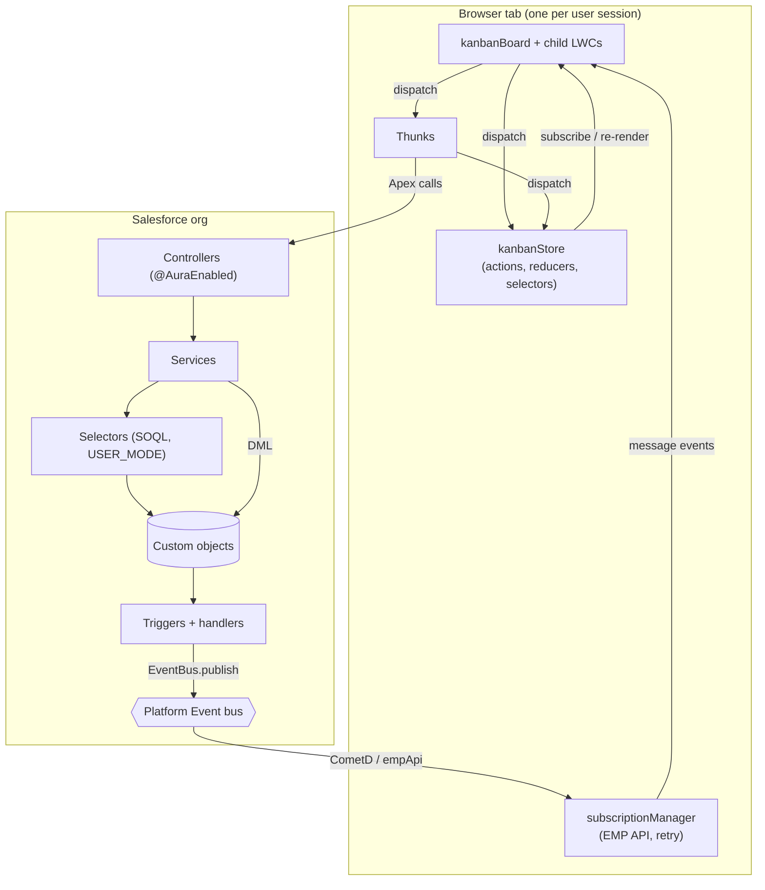
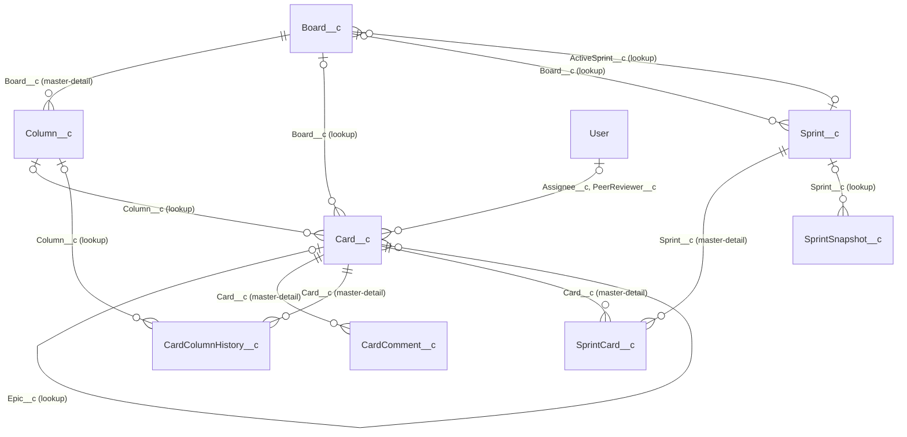
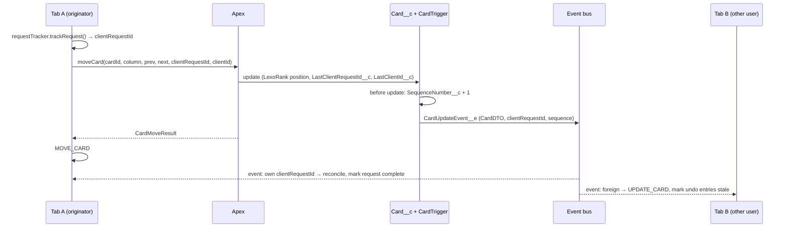

# Alex Architecture

This document describes how Alex is built: the data model, the Apex and
Lightning Web Component (LWC) layers, client state management, real-time
synchronization, security, and testing. It is written for contributors. For
working rules and commands, see [AGENTS.md](../AGENTS.md); for setup, see
[QUICKSTART.md](QUICKSTART.md).

## Overview

Alex is a real-time, collaborative Kanban and sprint board that runs natively
on Salesforce. It is distributed as a managed second-generation package (2GP)
with the namespace `OpenSF`.

| Concern        | Technology                                                               |
| :------------- | :----------------------------------------------------------------------- |
| UI             | Lightning Web Components, SLDS                                           |
| Client state   | `kanbanStore`: a Redux-style store with middleware, thunks and undo/redo |
| Back end       | Apex (controller, service, selector, DTO layers), trigger handlers       |
| Real-time sync | High-volume Platform Events consumed through `lightning/empApi`          |
| Ordering       | LexoRank string positions for cards and columns                          |
| Metadata       | API version 67.0                                                         |
| Testing        | Jest (LWC), Apex tests, Playwright (E2E, TypeScript)                     |
| Tooling        | Salesforce CLI, Node.js 22, Prettier, ESLint, Code Analyzer v5           |

Two Lightning apps ship in the package: `Alex` (standard navigation) and
`Alex Console` (console navigation). The board is the `kanbanBoard`
component on the Board record page (`Board_Record_Page`); board administration
is `adminManagement` on the `Admin_Management` app page.

### Namespace convention

Metadata source is **unprefixed** (`objects/Card__c/fields/Status__c...`).
Runtime code (Apex, SOQL, LWC JavaScript, `@salesforce/schema` imports) uses
the **prefixed** names (`OpenSF__Card__c`, `OpenSF__Status__c`). This
document uses unprefixed names when it describes metadata and prefixed names
when it quotes code.

## High-level architecture



The flow for every change is the same: a user action dispatches a thunk, the
thunk calls Apex, Apex performs DML, a trigger publishes a Platform Event, and
every open board (including the originator) receives it, filters it, and
updates its store.

## Data model

Source: [`force-app/main/default/objects/`](../force-app/main/default/objects/).
Relationships below are taken from the field metadata.



### Custom objects

| Object                 | Sharing              | Purpose and notable fields                                                                                                                                                                                                                                                                          |
| :--------------------- | :------------------- | :-------------------------------------------------------------------------------------------------------------------------------------------------------------------------------------------------------------------------------------------------------------------------------------------------- |
| `Board__c`             | Read/Write           | A board. `Type__c` (Project, Personal, Team, Sprint), `Status__c`, `Active__c`, `ActiveSprint__c`, `DefaultSprintDurationDays__c`, `ColumnCount__c` (roll-up count of columns).                                                                                                                    |
| `Column__c`            | Controlled by parent | A column. `LexoRankPosition__c` (order), `Category__c` (Backlog, To Do, In Progress, Testing, Review, Done, Released), `Status__c` (applied to cards moved in), `WipLimit__c`, `CardCount__c` (maintained by the card trigger).                                                                     |
| `Card__c`              | Read/Write           | A work item. `Subject__c`, `Description__c` (HTML), `CardType__c` (Story, Bug, Improvement, Spike, Task, Epic), `Priority__c`, `StoryPoints__c`, `DueDate__c`, `LexoRankPosition__c`, `SequenceNumber__c`, `LastClientRequestId__c`, `LastClientId__c`, `DoneDate__c`, `EpicCardsCount__c`.        |
| `CardComment__c`       | Controlled by parent | Comment on a card (`Body__c`).                                                                                                                                                                                                                                                                      |
| `CardColumnHistory__c` | Controlled by parent | One row per stay of a card in a column (`EnteredAt__c`, `ExitedAt__c`, `DurationMinutes__c`). Written only by the card trigger; feeds cycle-time and cumulative-flow analytics.                                                                                                                    |
| `Sprint__c`            | Read/Write           | A sprint. `Status__c` (Planning, Active, Completed, Cancelled), `StartDate__c`, `EndDate__c`, `Goal__c`, `SortOrder__c`, `TotalStoryPoints__c`, `CompletedStoryPoints__c`, `Velocity__c`.                                                                                                           |
| `SprintCard__c`        | Controlled by parent | Junction between sprint and card (`AddedDate__c`, `RemovedDate__c`, `CompletedInSprint__c`, `StoryPointsAtAdd__c`).                                                                                                                                                                                |
| `SprintSnapshot__c`    | Read/Write           | Point-in-time sprint totals for burndown (`SnapshotDate__c`, `TotalPoints__c`, `CompletedPoints__c`, `RemainingPoints__c`, card counts).                                                                                                                                                           |

Notes:

- A card whose `Column__c` is empty but whose `Board__c` is set is a
  **backlog** card. Board cards are queried through `Column__r.Board__c`.
- `Column__c` and `Board__c` on `Card__c` are lookups with `SetNull`, so
  deleting a column clears `Column__c` on its cards rather than deleting them.
- Epics are cards with `CardType__c = 'Epic'`; children reference them through
  the `Epic__c` self-lookup.
- Picklists `Card__c.Status__c` / `Column__c.Status__c` share the `CardStatus`
  global value set; `Column__c.Category__c` uses `ColumnCategory`.

### Custom metadata

| Type                      | Purpose                                                                                                                    |
| :------------------------ | :------------------------------------------------------------------------------------------------------------------------- |
| `CardCustomField__mdt`    | Extra `Card__c` fields to show on cards (`FieldApiName__c`, `DisplayLabel__c`, `FieldType__c`, `SortOrder__c`, `Active__c`). |
| `CardTypeIcon__mdt`       | Maps a card-type picklist value to an SLDS icon name.                                                                      |
| `KanbanBoardSettings__mdt` | `Modal_Settings` record: comma-separated field list for the card panel (`FieldNames__c`).                                  |

### Platform events

All three events are high-volume with **Publish Immediately** behavior.

| Event                  | Fields                                                                                             | Published by                                         |
| :--------------------- | :------------------------------------------------------------------------------------------------- | :--------------------------------------------------- |
| `CardUpdateEvent__e`   | `EventType__c`, `Payload__c`, `ClientRequestId__c`, `ClientId__c`, `SequenceNumber__c`             | `CardTriggerHandler` (after insert/update/delete/undelete) |
| `ColumnUpdateEvent__e` | `EventType__c`, `Payload__c`                                                                       | `ColumnTriggerHandler` (after insert/update/delete)  |
| `SprintUpdateEvent__e` | `EventType__c`, `Payload__c`, `BoardId__c`, `ClientId__c`                                          | `SprintCardTriggerHandler`, `SprintService`          |

Event type values come from `KanbanEnums`: card and column events use
`create`, `update`, `delete` (cards also `undelete`); sprint events use
`sprint_started`, `sprint_completed`, `cards_added`, `card_added`,
`card_removed`, `card_updated`. Card and column payloads are the serialized
DTO; delete payloads carry only `Id`, `Name` and `columnId` (card) or
`boardId` (column).

## Apex back end

Source: [`force-app/main/default/classes/`](../force-app/main/default/classes/).
The layering convention is:

```
Controller (@AuraEnabled) → Service (business logic, DML) → Selector (SOQL) → DTO
```

Controllers are thin facades that delegate to services and wrap errors in
`AuraHandledException`. Services own business rules and DML. Selectors own
SOQL and run `WITH USER_MODE`. DTOs shape data for LWC.

| Layer      | Class                        | Responsibility                                                                                                         |
| :--------- | :--------------------------- | :--------------------------------------------------------------------------------------------------------------------- |
| Controller | `KanbanBoardController`      | Board load, card CRUD and moves, backlog, epics, sprints, analytics, comments, files, polling, config.                  |
|            | `ColumnManagementController` | Column CRUD, reorder, default column templates.                                                                        |
|            | `AdminController`            | Board CRUD, onboarding status, upgrade check, card custom-field configuration (Metadata API).                                         |
| Service    | `KanbanBoardService`         | Assembles board data, column moves, incremental updates for polling, modal settings, card-type icons, runtime config.  |
|            | `KanbanCardService`          | Card create/update/move/delete, column status and done-date rules, LexoRank backfill.                                  |
|            | `SprintService`              | Sprint lifecycle (create, start, complete, delete, reorder), sprint membership, snapshots, burndown, velocity.          |
|            | `AnalyticsService`           | Cycle time and cumulative flow from `CardColumnHistory__c`.                                                            |
|            | `EpicService`                | Epic summaries and progress.                                                                                           |
|            | `CardCommentService`         | Card comment CRUD.                                                                                                     |
|            | `UpgradeCheckService`        | Post-upgrade checks for the Admin page: required picklist values and retired flows still active (see [UPGRADING.md](UPGRADING.md)). |
| Selector   | `KanbanBoardSelector`        | Board, column, card, backlog, epic and user queries; shared field lists (`CARD_FIELDS`, `COLUMN_FIELDS`).               |
|            | `BoardSelector`              | Board lists and onboarding counts.                                                                                     |
|            | `SprintSelector`             | Sprint, sprint-card and snapshot queries.                                                                              |
| DTO / type | `KanbanBoardDTO`             | Inner DTO classes (`BoardDTO`, `ColumnDTO`, `CardDTO`, `SprintDTO`, ...) and list converters.                          |
|            | `CardUpdateRequest`          | Typed wrapper; `fromMap()` converts the LWC `Map<String, Object>` before it reaches the service layer.                  |
|            | `KanbanEnums`                | Enums and picklist/event-type value converters. Use these instead of string literals.                                  |
| Utility    | `LexoRank`                   | `between(prev, next)` computes an ordering key between two neighbors.                                                  |
|            | `SprintSnapshotScheduler`    | `Schedulable` that snapshots all active sprints.                                                                       |
| Triggers   | `TriggerHandler`             | Base class: context dispatch, per-handler bypass, recursion guard (`maxLoopCount = 20`).                               |
|            | `CardTriggerHandler`         | Sequence numbers, column card counts, column history, epic child counts, `CardUpdateEvent__e`.                          |
|            | `ColumnTriggerHandler`       | `ColumnUpdateEvent__e`.                                                                                                |
|            | `SprintCardTriggerHandler`   | `SprintUpdateEvent__e` for sprint-card changes.                                                                        |
|            | `TriggerContext`             | Transaction-scoped map of record Id to client request Id.                                                              |

Triggers (`CardTrigger`, `ColumnTrigger`, `SprintCardTrigger`) contain no
logic; each instantiates its handler, passes the trigger context and calls
`execute()`.

### Card trigger behavior

- **Before update:** increments `SequenceNumber__c` when a meaningful field
  changed (subject, description, column, priority, due date, assignee, color,
  position, status, story points, refinement flag) and the caller did not set it.
- **After insert/update/delete/undelete:** recomputes `Column__c.CardCount__c`
  and `EpicCardsCount__c` with aggregate queries, opens and closes
  `CardColumnHistory__c` rows on insert and column changes, then publishes one
  `CardUpdateEvent__e` per card. For inserts and updates the cards are
  re-queried so the payload is a full `CardDTO`.

### Sprint behavior

- Starting a sprint sets `Board__c.ActiveSprint__c`; completing it clears the
  field and applies per-card dispositions (back to backlog or to another
  sprint).
- Moving a card into a `Done` or `Released` column marks its `SprintCard__c`
  completed; moving it back to active work reverts that
  (`SprintService.autoUpdateSprintCompletion`).
- Snapshots are written when a sprint starts and completes. Daily snapshots
  require scheduling `SprintSnapshotScheduler` in the org; the package does
  not schedule it.

## LWC front end

Source: [`force-app/main/default/lwc/`](../force-app/main/default/lwc/).
Only `kanbanBoard`, `adminManagement` and `columnManagement` are exposed in
App Builder; everything else is composed by them.

| Component                     | Role                                                                                   |
| :---------------------------- | :------------------------------------------------------------------------------------- |
| `kanbanBoard`                 | Container. Owns the store instance, renders columns and cards, wires all child components. |
| `kanbanCardPanel`             | Card detail panel: fields, comments, files, delete (via `lightning/confirm`).           |
| `kanbanBacklogView`           | Backlog and sprint planning view with its own drag-and-drop and context-menu handlers.  |
| `kanbanFilterBar`             | Search and filter controls.                                                            |
| `kanbanContextMenu`           | Generic right-click menu.                                                              |
| `kanbanSprintHeader`          | Active sprint summary.                                                                 |
| `kanbanSprintModal`           | Create and start sprints.                                                              |
| `kanbanSprintComplete`        | Complete a sprint and choose dispositions for unfinished cards.                        |
| `kanbanSprintReports`         | Burndown and velocity.                                                                 |
| `kanbanAnalytics`             | Cycle-time analytics; hosts `kanbanCumulativeFlowDiagram`.                             |
| `columnManagement`            | Column CRUD and ordering (embedded in the board and exposed on app pages).             |
| `adminManagement`             | Board administration and card custom-field configuration.                              |
| `subscriptionManager`         | EMP API subscription with `retryManager`.                                              |
| `connectionStatusIndicator`   | Displays the real-time connection status.                                              |
| `kanbanStore`                 | The client store (service module, no UI).                                              |
| `storeSubscriptionMixin`      | `applyStoreSubscription()` helper for components that consume the store.               |
| `toastManager`, `toastUtils`  | Toast component and shared toast helpers.                                              |
| `navigationUtil`              | `NavigationMixin` wrapper.                                                             |

`kanbanBoard` delegates most logic to plain JavaScript modules:

- `handlers/`: `cardOperations`, `dragDropHandler` (HTML5 drag and drop with
  a DOM placeholder), `eventHandler` (Platform Event processing),
  `subscriptionEventHandler` (connection status and polling hand-off).
- `helpers/`: `clientIdGenerator`, `requestTracker` (pending request IDs),
  `reducerQueue` (serial operation queue), `textDecorationHelper`.
- `managers/`: `boardDataLoader` (load and polling), `filterManager`,
  `contextMenuManager`, `lifecycleManager`, `mobileNavigationManager`,
  `undoRedoManager` (Ctrl/Cmd+Z, Ctrl/Cmd+Y), `toastManager`.

The store is created by `kanbanBoard` (one instance per board component) and
passed to children through a `store` property.

## State management

Source: [`lwc/kanbanStore/`](../force-app/main/default/lwc/kanbanStore/).
All state changes go through the store: actions, pure reducers, selectors,
with side effects in thunks.

| Folder        | Contents                                                                                                    |
| :------------ | :---------------------------------------------------------------------------------------------------------- |
| `core/`       | `store.js` (`KanbanStore`, `createStore`), `actionTypes.js`.                                                |
| `state/`      | `actions.js`, `reducers.js` (root reducer, `initialState`), `reducers/` (domain reducers), `selectors.js`.  |
| `thunks/`     | `boardThunks`, `cardThunks`, `columnThunks`, `sprintThunks`, `epicThunks`, `analyticsThunks`.              |
| `middleware/` | `thunkMiddleware`, `undoMiddleware`, `loggingMiddleware`, `devToolsMiddleware`.                             |
| `undo/`       | `undoManager`, `undoableActions`.                                                                           |
| `devtools/`   | `devToolsBridge` (console bridge) and its [README](../force-app/main/default/lwc/kanbanStore/devtools/README.md). |
| `utils/`      | `dataProcessors` (card enrichment), `positionCalculator`, `stateHelpers`.                                  |

### State shape

From `state/reducers.js`:

```javascript
{
    board: null,              // BoardDTO plus customFieldConfigs
    boardId: null,
    columns: [],              // ColumnDTO[], each with a nested, position-sorted cards[]
    dragState: null,          // preview copy of columns during a drag
    isDragging: false,
    dragSource: null,
    isLoading: false,
    error: null,
    subscriptionStatus: 'disconnected',
    syncState: 'idle',        // 'idle' | 'syncing' | 'failed'
    pendingOperations: [],
    lastSyncTime: null,
    lastSyncError: null,
    pollingUpdateDetected: null,
    activeSprint: null,
    sprints: [],
    backlogCards: [],
    backlogSyncing: 0,        // > 0 while backlog reorders are in flight
    sprintCards: [],
    planningSprintCards: [],
    backlogVisible: false,
    selectedBacklogCards: [],
    epicSummaries: []
}
```

Cards are `CardDTO` objects (`Id`, `subject`, `columnId`, `position`,
`sequenceNumber`, `assignee`, `epic`, `customFields`, ...) enriched on the
client with display properties by `dataProcessors.enrichCardData`.

### Reducers and actions

`rootReducer` runs the domain reducers in sequence: `board`, `columns`,
`cards`, `appState`, `sync`, `sprint`, `backlog`, `drag`. `RESET` returns
`initialState`. The main action types in `core/actionTypes.js`:

- **Board / columns:** `SET_BOARD`, `SET_BOARD_ID`, `SET_COLUMNS`, `UPDATE_COLUMNS`
- **Cards:** `ADD_CARD`, `UPDATE_CARD`, `DELETE_CARD`, `MOVE_CARD`
- **Drag:** `START_DRAG`, `UPDATE_DRAG_POSITION`, `COMMIT_DRAG`, `CANCEL_DRAG`
- **App / sync:** `SET_LOADING`, `SET_ERROR`, `SET_SUBSCRIPTION_STATUS`,
  `START_OPERATION`, `COMPLETE_OPERATION`, `FAIL_OPERATION`, ...
- **Sprints, backlog, epics:** `SET_SPRINTS`, `MOVE_CARD_TO_SPRINT`,
  `SET_BACKLOG_CARDS`, `REORDER_BACKLOG`, `SET_EPIC_SUMMARIES`, ...

Reducers return new objects; card and column updates deep-copy `columns`
with `structuredClone`. `getState()` returns a shallow-frozen copy of the
state. The `getColumns` selector returns `dragState` while a drag is in
progress and `columns` otherwise.

### Middleware and thunks

`createStore()` builds the chain `thunk → undo → (logging)`:

- **Thunk** calls function actions with `(dispatch, getState)`.
- **Undo** records undoable actions (see below).
- **Logging** is added only when `createStore({ enableLogging: true })`.

Thunks call Apex and then dispatch plain actions. `moveCardAsync` and
`createCardAsync` compute LexoRank neighbors with `positionCalculator`, call
Apex, and update the store when the call returns. `updateCardAsync` applies
the change optimistically, then applies the server's `CardDTO`.

### Undo and redo

Undo is command-based and persists to the server. `undoMiddleware` captures
context for `MOVE_CARD`, `ADD_CARD` and `UPDATE_CARD` (`DELETE_CARD` is not
undoable). Undoing dispatches a reverse thunk, for example moving the card
back or deleting a newly created card. The stack keeps the last 10 entries.
When another client changes a card, `eventHandler` marks that card's entries
stale and they are skipped. Keyboard shortcuts come from `undoRedoManager`.

### DevTools

`devToolsMiddleware` and `devToolsBridge` add an action history (last 200
entries with state snapshots and diffs), time travel and a console bridge
(`window.__KANBAN_DEVTOOLS__`). They are **off by default**: `kanbanBoard`
calls `store.enableDevTools()` only when `getKanbanConfig()` returns
`enableDevTools = true`, and in this repository that method always returns
`false`. To use DevTools locally, change `KanbanBoardService.getKanbanConfig()`
in a development org.

## Real-time synchronization



### Subscription

`kanbanBoard` hosts two `subscriptionManager` instances: one on
`/event/OpenSF__CardUpdateEvent__e` and, for Sprint boards, one on
`/event/OpenSF__SprintUpdateEvent__e`. Each subscribes with replay `-1` (new
events only) and reports status changes (`connecting`, `connected`, `error`,
`disconnected`, `polling`) to the store and `connectionStatusIndicator`.

- **Retry:** on a subscribe failure or an `empApi` error, `retryManager`
  retries after 2 s and then 4 s; on the third failure the status becomes
  `polling` and the board falls back to polling.
- **Quiet boards:** a connected board with no activity receives no events, so
  the absence of events is not treated as a failure; only `empApi` errors are.
- **Polling fallback:** `boardDataLoader.startPolling()` calls
  `getIncrementalUpdates(boardId, lastSyncTime)` every 15 s and applies the
  modified cards with `UPDATE_CARD`. Polling stops when the subscription
  reports `connected` again (for example when the next event arrives).
- **Window focus:** `lifecycleManager` fetches incremental updates if the last
  sync is older than 30 s and resubscribes if the status is not `connected`.

Channels are org-wide: every subscriber receives every card event in the org,
and each client filters for its own board.

### Processing a card event

`eventHandler.handlePlatformEvent` applies these checks in order:

1. **Board filter.** Keep the event if `payload.columnId` is a column in local
   state, `payload.boardId` matches, or the card is already on the board.
2. **Sequence check.** Ignore the event if `SequenceNumber__c` is not greater
   than the local card's `sequenceNumber`. This drops stale and duplicate
   events, including the echo of a change whose response already arrived.
3. **Own request.** If `ClientRequestId__c` is in this tab's
   `requestTracker`, mark the request complete. Skip `create` events (the card
   is already in state) and apply `update`/`delete` to reconcile with the
   server DTO.
4. **Own window with pending work.** If the event came from this tab
   (`ClientId__c`) and the card still has pending requests, re-check after
   500 ms.
5. **Foreign change.** Mark undo entries for the card stale, then dispatch
   `UPDATE_CARD`, `ADD_CARD` or `DELETE_CARD`.

If parsing fails, the board reloads in full. Sprint events trigger a full
board reload.

### Operation queue

Board moves and creates go through `reducerQueue`, which runs operations one
at a time. A move still waiting in the queue is merged with a newer move of
the same card, so rapid drags of one card produce fewer server calls. Each
operation updates `pendingOperations` and `syncState` in the store.

## Security model

The package targets API 67.0. Rules are summarized in
[AGENTS.md](../AGENTS.md#2-security-api-670); this section describes how they
are applied.

- **Sharing.** Every Apex class declares sharing: `with sharing`, or
  `inherited sharing` for `CardUpdateRequest`, `KanbanEnums` and
  `TriggerContext`. There is no `without sharing` code.
- **Queries.** SOQL runs `WITH USER_MODE`. `WITH SECURITY_ENFORCED` is not used
  (it does not compile at v67). Exceptions:
    - `__mdt` queries (configuration, not user data).
    - `ContentDocumentLink` in `getCardFiles` / `deleteCardFile`. Access is
      enforced through the parent card: the caller must be able to read the
      card (`KanbanBoardSelector.getCardById`, `USER_MODE`), the link must
      reference that card, and the delete itself runs in `USER_MODE`.
- **User DML.** The convention for new code is `Security.stripInaccessible`
  followed by `Database.<op>(..., AccessLevel.USER_MODE)`. Inserts and deletes
  follow it; several existing update paths (card moves and updates, column
  moves, sprint updates) use `update Security.stripInaccessible(...)` with
  sharing enforced by the class. Updates build a record with `Id` plus the
  changed fields, so non-reparentable master-detail fields are never re-sent.
- **System-mode bookkeeping.** The card trigger updates `CardCount__c`,
  `EpicCardsCount__c` and `CardColumnHistory__c` with `WITH SYSTEM_MODE`
  queries and `AccessLevel.SYSTEM_MODE` DML. These are app-managed values that
  must stay consistent even when the user lacks FLS on them. Each block has an
  inline `SYSTEM_MODE rationale` comment, and record sharing still applies
  because the handler is `with sharing`.
- **Metadata API.** `AdminController.saveCardCustomField` and
  `deactivateCardCustomField` deploy `CardCustomField__mdt` records through
  `Metadata.Operations.enqueueDeployment`. Because that runs in system context,
  both require the `ManageCardFields` custom permission
  (`FeatureManagement.checkPermission`).
- **Permission sets.** `Alex_Admin` (full access, includes `ManageCardFields`)
  and `Alex_User` (day-to-day use).
- **Record access.** `Board__c`, `Card__c`, `Sprint__c` and
  `SprintSnapshot__c` default to Public Read/Write. Columns, comments, column
  history and sprint cards are controlled by their parent.
- **LWC.** Confirmations use `lightning/confirm`; no component uses
  `innerHTML` or `window.confirm`.
- **Event payloads.** Platform Event payloads go out on org-wide channels and
  are filtered by board on the client. Any user who can subscribe to the
  channel receives payloads for all boards.

## Performance

- **One round trip to load a board.** `getBoardData` returns the board, its
  columns, its cards, card-type icons and custom-field configuration
  together; backlog or sprint data loads next, and epic summaries load in the
  background.
- **String ordering.** LexoRank positions mean a move or insert writes one
  record, never a renumbering of the column.
- **Incremental event updates.** Events update one card in the store; a full
  reload happens only on parse errors, sprint events, some failure paths and
  manual refresh.
- **Coalesced writes.** `reducerQueue` merges a queued move with a newer move
  of the same card.
- **Bulk-safe triggers.** Counts are computed with one aggregate query per
  trigger invocation; events are published in one `EventBus.publish` call.
- **Render work.** Decorated column output is cached by reference
  (`textDecorationHelper`), search input is debounced by 150 ms
  (`filterManager`), and drag handling caches card elements per column.

## Testing and CI

| Layer | Location                                                                         | Notes                                                                                     |
| :---- | :------------------------------------------------------------------------------- | :---------------------------------------------------------------------------------------- |
| Jest  | `lwc/<component>/__tests__/`, shared helpers and mocks in [`force-app/test/`](../force-app/test/) | Store reducers, selectors, thunks, utils, board handlers and managers, admin page. `jest.config.js` sets an 80% threshold; CI gates on test results only until coverage reaches it. |
| Apex  | `force-app/main/default/classes/*Test.cls`                                       | Test classes next to the classes they cover, plus scenario tests such as `ConflictResolutionTest`, `CardSequenceNumberTest` and `PerformanceBenchmarkTest`. Org coverage of at least 75%. |
| E2E   | [`e2e/`](../e2e/)                                                                | Playwright, TypeScript strict. `specs/`, `pages/` (page objects), `fixtures/` (including multi-user), `helpers/`. |

E2E tests run **locally** against an `OpenSF`-namespaced scratch org, never in
CI. `e2e/global-setup.ts` seeds data with
`scripts/apex/CreateFilledKanbanBoard.apex` and saves an authenticated
session from `SCRATCH_ORG_URL`. [`playwright.config.ts`](../playwright.config.ts)
defines Chromium, Firefox and WebKit projects, uses one retry and traces on
the first retry. See [AGENTS.md](../AGENTS.md#e2e-tests) for the commands.

[`.github/workflows/ci.yml`](../.github/workflows/ci.yml) runs static checks
only, on pull requests and pushes to `main`:

1. Prettier (`npm run prettier:verify`)
2. ESLint (`npm run lint`)
3. E2E type-check (`npm run type-check:e2e`)
4. Jest with coverage (`npm run test:unit:coverage`)
5. `npm audit --omit=dev` (report only)
6. Salesforce Code Analyzer v5: the `AppExchange` rule selector is a gate
   (fails on severity 1 or 2); `Recommended:Security` is report only.

Apex tests, deployments and packaging need an org and are run locally.

## Design decisions

- **LexoRank ordering.** `LexoRankPosition__c` is a sortable string
  (`bucket|key`). The client sends the positions of the new neighbors and
  `LexoRank.between` computes a key between them, so concurrent moves in the
  same column do not need to renumber other cards. Missing positions are
  backfilled on load.
- **Separate drag state.** The store keeps a drag preview (`dragState`) apart
  from committed `columns`, so a cancelled drag never touches committed state.
  The board's current drag handler shows the preview with a DOM placeholder
  and does not dispatch the drag actions; the store updates when the move
  completes.
- **Trigger-published events.** Events are published from triggers, not
  controllers, so every write (UI, API, Flow, data loads) reaches open boards,
  and payloads are built from re-queried records.
- **`clientRequestId`, `clientId` and sequence numbers.** A request ID ties an
  event to the tab request that caused it; a per-tab client ID separates two
  tabs of the same user; the trigger-maintained `SequenceNumber__c` gives a
  monotonic version per card, so stale or duplicate events are dropped
  regardless of arrival order.
- **Polling fallback.** If the event stream fails, the board polls for
  modified cards instead of silently going stale.

## Known limitations

- **Polling is partial.** `getIncrementalUpdates` returns modified cards only.
  Cards created or deleted elsewhere appear after the next full reload.
- **Column events are not consumed.** `ColumnUpdateEvent__e` is published,
  but no component subscribes to it; other users see column changes after a
  reload.
- **Sprint events are not filtered by board.** Any `SprintUpdateEvent__e`
  causes a full reload on every open Sprint board, although the event carries
  `BoardId__c`.
- **Undelete is not handled.** `undelete` card events are ignored by the
  client.
- **Server-side conflict detection is not wired up.**
  `moveCardWithConflictDetection` and `updateCardWithConflictDetection` exist,
  but the UI calls `moveCard` and `updateCard`; ordering is protected
  client-side by sequence numbers only.
- **Optimistic updates are not reverted.** If `updateCardAsync` fails, the
  optimistic change remains until the next reload.
- **No LexoRank rebalancing.** Keys grow as items are repeatedly inserted
  between the same neighbors, and no job rebalances them.
- **Whole-board load.** All board cards load in one query; there is no
  pagination or list virtualization.
- **Publish Immediately.** Events are sent even if the surrounding transaction
  later rolls back.
- **Daily snapshots need scheduling.** `SprintSnapshotScheduler` must be
  scheduled manually for daily burndown points.
